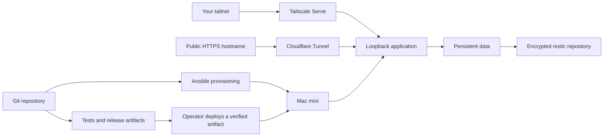

# home-infra

**Turn a dedicated Mac mini into a home server you can rebuild from Git.**

[](https://github.com/srichards2103/home-infra/actions/workflows/ci.yml)

Ansible provisions the machine. A small, standard-library Python controller deploys
versioned applications as unprivileged launchd services. Tailscale provides private
access; optional Cloudflare Tunnel routes selected hostnames to local services.
Restic provides encrypted backups and explicit restore operations.

Built for one dedicated Mac first. No Kubernetes, Docker Desktop, or permanently
privileged CI runner required.



## What is implemented

| Area | Behavior |
| --- | --- |
| Provisioning | Homebrew packages, host name, AC power settings, dedicated service users, directories and launchd definitions |
| Deployment | SHA-256 verification, bounded archive extraction, immutable release names, serialized operations, health checks and automatic rollback |
| Recovery | A durable deployment journal and explicit recovery after an interrupted operation |
| Networking | Optional CLI Tailscale daemon and locally managed Cloudflare Tunnel; no router port forwarding |
| Backups | Scheduled restic snapshots, integrity checks, restore into a fresh directory, retention preview |
| Delivery | Locked development dependencies, Linux/macOS CI, downloadable controller and example release artifacts |

**Status:** initial implementation. Automated tests exercise the controller, real
HTTP processes, archive security and rendered provisioning configuration. A full
factory-reset provisioning and reboot exercise has **not** been performed. See
[validation](docs/validation.md) for the distinction between tests and host acceptance.

## Try it without changing your Mac

Install [uv](https://docs.astral.sh/uv/getting-started/installation/), then:

```sh
git clone https://github.com/srichards2103/home-infra.git
cd home-infra
uv sync --locked
uv run homeinfra validate examples/hello/service.json
uv run homeinfra render examples/hello/service.json
make test
make demo
```

In another terminal, `curl http://127.0.0.1:8090/healthz` returns the example's
release identity. These commands do not install system services. Stop the demo
with Ctrl-C before deploying it to the same port.

## Provision a dedicated Mac

1. Follow [first boot](docs/first-boot.md): finish macOS setup, install command-line
   tools and Homebrew, and establish an administrator account and recovery access.
2. Run `./bootstrap.sh` from your checkout. It installs development dependencies,
   builds the controller and creates an ignored local inventory.
3. Edit `inventory/local.yml`. Review host, connection and service settings.
4. Run `make plan`, review the changes, then run `make apply`.
5. Follow [deployments](docs/deployments.md) to install the example service and
   [networking](docs/networking.md) to choose its audience.

`make apply` is the explicit host-change boundary. It does not deploy applications,
enroll accounts, publish DNS records, disable FileVault, or create a CI runner.
The default example enables neither tunnel nor backups.

## Design decisions

- **Native launchd services:** run independently of an interactive desktop session.
  Applications use separate accounts; deployments require the trusted administrator.
- **Build once, deploy a named release:** deployment verifies an expected digest,
  activates the release, and checks its HTTP health endpoint. Failed health checks
  restore the previous release. This is a stop/start deployment with brief downtime.
- **Separate code, state and credentials:** release directories are root-owned;
  mutable data belongs to each service. Public manifests contain secret file paths,
  never values. Application dependencies must be included or installed explicitly.
- **Private by default:** applications bind to loopback. A tailnet route or public
  hostname is an explicit configuration decision. A public tunnel does not supply
  application authentication.
- **Reviewed upgrades:** CI builds and tests; deployments are explicit. Pushing to
  `main` does not silently execute new code as root on your home network.

The desired configuration is reproducible; the complete macOS installation is not
bit-for-bit reproducible. macOS, Homebrew formulas and account enrollment have their
own update and trust boundaries. Existing hosts may need migration before adoption.

## Documentation

- [First boot and provisioning](docs/first-boot.md)
- [Deployments, manifests and SSH delivery](docs/deployments.md)
- [Private and public networking](docs/networking.md)
- [Operations, backups and recovery](docs/operations.md)
- [Architecture and trust boundaries](docs/architecture.md)
- [Validation and host acceptance](docs/validation.md)
- [Contributing](CONTRIBUTING.md) · [Security](SECURITY.md) · [MIT license](LICENSE)

## Development

```sh
make setup
make check
```

Tests use temporary directories and injected process backends. They never invoke
the real launchctl, change accounts, enroll tunnels, or apply Ansible to the host.
The same suite runs on GitHub-hosted Linux and macOS runners.
